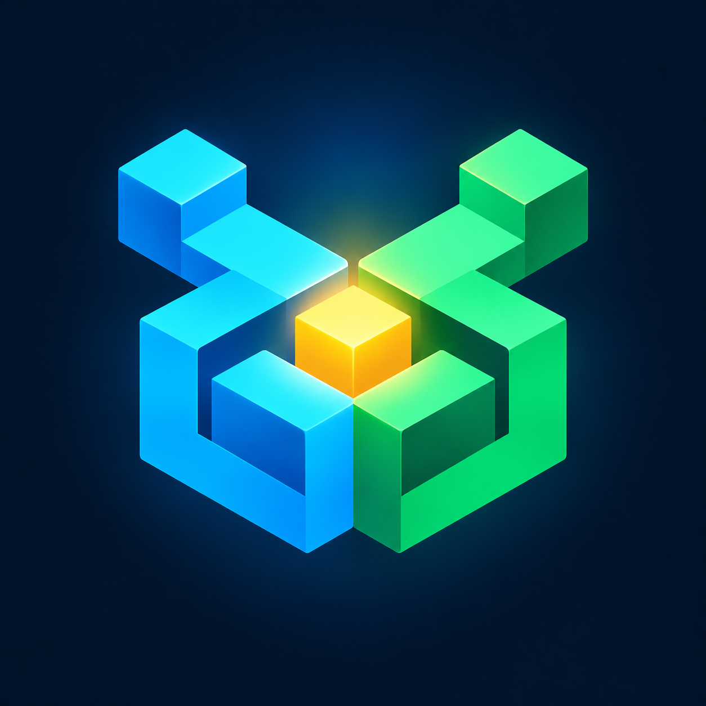

# MineConflux

<p align="center">
  
</p>

English | [简体中文](README.md)

**One identity. Both editions.**

MineConflux is a self-service Java/Bedrock account migration and linking mod for Fabric servers running Geyser and Floodgate.

Floodgate linking makes a Bedrock player use a Java identity on future joins, but it does not resolve conflicts when both identities already have progress. This project verifies ownership of both identities, previews their saves, lets the player choose which progress to keep, creates a backup, optionally migrates the Bedrock save to the Java UUID, and finally creates a Floodgate local link.

> **Warning:** This mod writes real player saves. Test on a copy of the world and take a complete backup before production use. It is not a periodic two-way synchronizer: after linking, both editions use the same Java UUID and therefore the same save.

## Highlights

- Separate one-time `/linkcode` verification for Java and Bedrock identities.
- Side-by-side save preview with Minecraft-style inventory and ender chest grids.
- Keep Java progress, or migrate Bedrock playerdata, advancements, statistics and scoreboard values to the Java identity.
- Automatic pre-migration backups and online-player checks.
- Floodgate Local Linking integration.
- Rate limiting, expiring operation sessions, secure response headers, and optional read-only demo data.
- Configurable bind address, port, expiration times and backup time zone.

## Requirements

- Minecraft 1.21.1
- Fabric Loader 0.19.5
- Fabric API 0.116.17+1.21.1
- Java 21+
- Floodgate Fabric 2.2.4 series
- A Floodgate Local Linking database extension, normally SQLite for a single server
- Geyser configured with Floodgate authentication

Install the release JAR into `mods/`. On first launch, the mod writes `config/mineconflux.json` and listens on `127.0.0.1:18080` by default. Follow the [deployment guide](docs/DEPLOYMENT.md) before exposing it through an HTTPS reverse proxy.

See the [Chinese README](README.md) for the complete installation, player workflow, migration scope and build instructions. See [data and recovery](docs/DATA_AND_RECOVERY.md) before operating on a production world.

## Build

```bash
./gradlew clean build
```

On Windows:

```powershell
.\gradlew.bat clean build
```

## License

[MIT](LICENSE). This is not an official Mojang Studios, Microsoft, GeyserMC, Geyser, or Floodgate project. Minecraft textures are not bundled; the web UI requests item textures from `assets.mcasset.cloud` at runtime.
